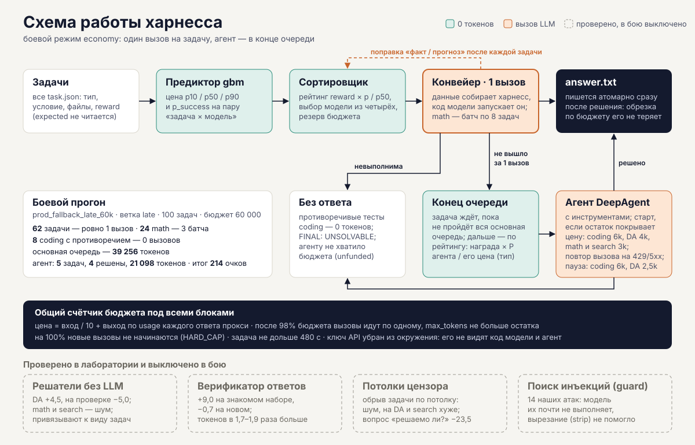
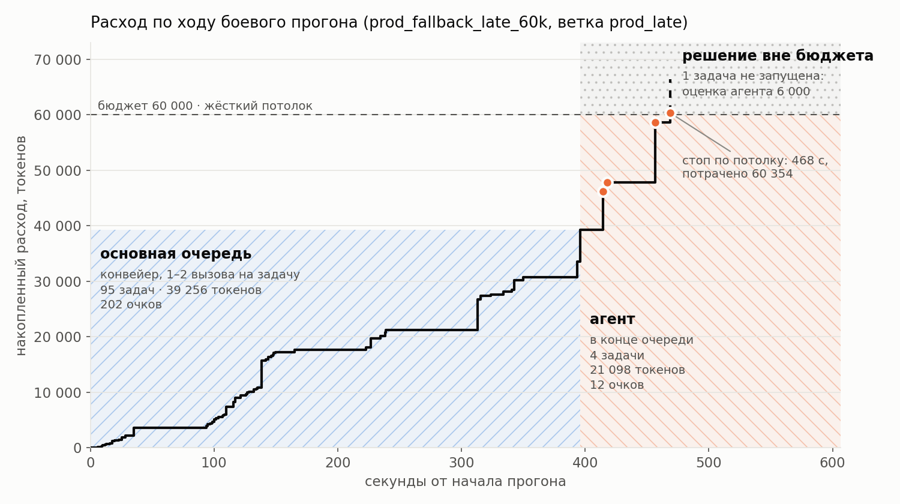

# Харнесс openJiuwen: решение задач под общий бюджет токенов

Харнесс получает каталог задач (`coding`, `math`, `search`, `data_analysis`) и общий бюджет `BUDGET`.
Его цель — набрать как можно больше баллов (`reward` верно решённых задач) и не тратить токены на невыполнимые задачи.
Стоимость считается по правилам конкурса: `вход / 10 + выход`, токены рассуждений входят в выход, кеш не учитывается.
Модели вызываются только через прокси организаторов. Каждый вызов идёт через `openjiuwen` (`DeepAgent`).

**Коротко** (боевой профиль, `prod_fallback_late_60k`, 100 задач, бюджет 60 000):
- задачу решает один вызов модели, контекст и проверку готовит сам харнесс: 62 задачи из 100 решены ровно за 1 вызов,
  24 задачи `math` — за 3 вызова батчами;
- агент с инструментами — второй уровень, в конце очереди: 0,57 очка на 1k токенов против 5,1 у конвейера;
- невыполнимые задачи `coding` закрываются детектором противоречивых тестов за 0 токенов: 8 из 8 в каждом из 30 прогонов;
- итог 214 очков, 80% верных, расход 60 355 при жёстком потолке бюджета;
- каждая настройка выбрана по A/B-прогонам автолаборатории: 202 эксперимента за 2026-11-08…14.

**Содержание:** [Главная идея](#главная-идея) · [Агент: где он нужен и где нет](#агент-где-он-нужен-и-где-нет) ·
[Сборка и запуск](#сборка-и-запуск) · [Как это работает](#как-это-работает) · [Боевая конфигурация](#боевая-конфигурация) ·
[Что пробовали и отключили](#что-пробовали-и-отключили) · [Автолаборатория](#как-велась-работа-автолаборатория) ·
[Расход токенов](#как-оценивается-расход-токенов) · [Невыполнимые задачи](#как-обнаруживаются-невыполнимые-задачи) ·
[Журнал](#журнал-и-траектории) · [Результаты](#результаты) · [openjiuwen](#что-пришлось-решить-при-работе-с-openjiuwen) ·
[Ограничения](#ограничения) · [Структура](#структура-репозитория)

## Главная идея

**Каждую задачу харнесс пытается решить за один вызов модели.** Данные для задачи собирает сам харнесс, без агента
и без инструментов: нужные фрагменты базы знаний, колонки таблиц, код и вывод упавших тестов. Модель отвечает
или пишет программу, а харнесс сам её запускает и проверяет. Такой конвейер стоит десятки–сотни токенов на задачу.

**Если не получилось, задача уходит в конец очереди.** (У `coding` перед этим есть вторая попытка: модель видит
вывод упавших тестов.) Агент `DeepAgent` с инструментами стоит
тысячи токенов на задачу, поэтому он запускается только после того, как пройдена вся основная очередь. Порядок —
по ожидаемой отдаче агента (награда × доля задач этого типа, которые агент решает / его средняя цена), и только пока
остаток бюджета покрывает ожидаемую цену агента. Дорогие задачи не съедают бюджет дешёвых.



В боевом прогоне на 100 задач (`prod_fallback_late_60k`, ветка `prod_late`) это выглядело так:
- каждая задача `search`, `data_analysis` и `coding` на конвейере решена ровно за 1 вызов;
- 24 задачи `math` решены за 3 вызова, батчами по 8;
- 8 невыполнимых `coding` закрыты за 0 вызовов детектором противоречивых тестов;
- агенту в конце очереди досталось 5 задач из 100: 4 решены, на пятую не хватило бюджета.



Боевой прогон `prod_fallback_late_60k`, ветка `prod_late`, 100 задач, бюджет 60 000. Основная очередь (синяя зона):
95 задач на конвейере за 395 с и 39 256 токенов, 202 очка. Агент (оранжевая зона): 4 отложенные задачи за 21 098 токенов,
12 очков; точки — задачи, решённые агентом. На 468-й секунде расход дошёл до потолка, и прогон остановился. Пятая
отложенная задача (награда 1) не запущена: агенту не хватило бюджета, его ожидаемая цена — 6 000 токенов. Это оценка
харнесса, а не факт, поэтому она показана пунктиром. Построено по журналу прогона: `tools/plot_readme.py`.

## Агент: где он нужен и где нет

### Конвейер — это агент, у которого цикл записан в коде

Агент с инструментами сам решает, что делать дальше: посмотреть файлы, прочитать нужный, запустить код, проверить
результат. За каждый такой шаг он платит вызовом модели. Но у задач конкурса формат известен заранее: где лежит база
знаний, где таблицы, где тесты. Поэтому шаги, которые агент выяснял бы вызовами модели, харнесс делает сам, кодом,
за 0 токенов: собирает контекст, запускает код модели, прогоняет тесты. Модели остаётся только то, что требует
рассуждения, — один вызов.

На 8 примерах организаторов (2026-11-07, `qwen3.6-35b-a3b-noreason`, оба способа решили 8 из 8, подробно в `SCRIPTS.md`):

| | Агент с инструментами | Конвейер | Разница |
|---|---|---|---|
| Токены (`вход / 10 + выход`) | 8 509 | 1 304 | в 6,5 раза |
| Вызовов модели | 26 | 9 | в 2,9 раза |
| Входных токенов на вызов | 2 578 | 552 | в 4,7 раза |
| Время прогона | 315 с | 61 с | в 5,2 раза |

Откуда разница:
- **Описание инструментов в каждом запросе.** Описание `bash` из `openjiuwen` — около 7 000 символов, то есть около 1 800
  входных токенов, и оно повторяется в каждом вызове. Первый вызов агента на простой `math` — 1 890–1 946 входных токенов,
  вызов конвейера на том же типе — 91–147.
- **Цикл «подумать → вызвать инструмент → прочитать».** Каждый шаг заново отправляет всю историю: у агента 2 вызова на `math`
  и `data_analysis`, 3–4 на `search`, 5–6 на `coding`.
- **Исследование вслепую.** Агент выясняет, какие файлы есть, и читает их по одному; конвейер кладёт нужное в запрос сразу.

### Почему агент не стоит в основном пути

- **Он дороже на единицу результата.** В боевом прогоне (`prod_fallback_late_60k`, `prod_late`) конвейер принёс 202 очка
  за 39 256 токенов (5,1 очка на 1k), агент — 12 очков за 21 098 токенов (0,57 очка на 1k), в 9 раз меньше.
- **Его цену нельзя предсказать.** Цена конвейера зависит от размера входа, и gbm-предиктор оценивает её с медианной
  ошибкой 0,12–0,30. Цена агента зависит от того, сколько кругов он сделает: во всех 30 прогонах на `mixed100_dev`
  (118 запусков) факт в медиане в 12,5 раза больше прогноза. Запуск агента сразу после провала конвейера ломает
  планирование бюджета: в пяти прогонах `economy` без потолка (`ab_runmode_adaptive_vs_economy_gbm_mix60k*`) агент работал
  на 1–5 задачах из 100 и съедал 20–65% расхода, одна задача стоила до 24 109 токенов, а при бюджете 60k прогон тратил до 76 608.
- **Он тратит токены там, где решения нет.** На невыполнимых задачах `coding` агент пытается заставить пройти
  противоречивые тесты: 8 344 токена на задачу (`coding_late_fallback`, ветка `inline_nodet`). Статический детектор
  закрывает те же задачи за 0 токенов с тем же или лучшим результатом (100% против 87,5%).

### Где агент окупается

По всем 2 401 запускам агента в 144 экспериментах лаборатории (`traj-analysis/agent_cost.py`). Агент здесь всегда
получает задачу, которую конвейер уже не решил:

| Тип | Запусков | Решено | Медиана цены | 90-й процентиль | Максимум | Очки на 1k токенов |
|---|---|---|---|---|---|---|
| `coding` | 1 332 | 62% | 3 092 | 8 702 | 45 517 | 0,47 |
| `data_analysis` | 453 | 57% | 1 392 | 4 373 | 14 548 | 1,09 |
| `math` | 504 | 29% | 1 409 | 4 278 | 13 713 | 0,39 |
| `search` | 112 | 33% | 0 | 3 624 | 6 060 | 1,26 |

- Агент полезен там, где решение нужно доводить итерациями по обратной связи среды: в `coding` он прогоняет тесты, правит
  и прогоняет снова. На 64 выполнимых задачах `coding` (`coding_late_fallback`) конвейер с агентом решил 96,9%,
  один конвейер — 87,5%.
- На `math` и `search` задачи, которые конвейер не решил, агент решает в 29% и 33% случаев: если модель не справилась
  с готовым контекстом, инструменты ей мало помогают.
- Долгие запуски окупаются хуже: среди запусков дороже 2 000 токенов решено 74–76% (до 6 000), дороже 10 000 — 35%.
  Продолжение после 6 000 токенов приносит 0,31 очка на 1k, после 10 000 — 0,20.

Отсюда место агента в харнессе: второй уровень после всей основной очереди, в порядке рейтинга
`награда × P(агент решит | тип) / средняя цена агента (тип)` и только пока остаток бюджета покрывает его ожидаемую цену.
P и средняя цена взяты из тех же запусков, только по выполнимым задачам (`executor.AGENT_STATS`). Рейтинг основной
очереди здесь не годится: предиктор знает только цену конвейера. По рейтингу, например, `data_analysis` с наградой 3 (0,86 очка на 1k) идёт раньше `coding` с наградой 5 (0,79). Запуск, перешедший порог своего типа (`coding` 6 000, `data_analysis` 2 500),
не обрывается, а встаёт на паузу и уступает бюджет следующим задачам (раздел «Как это работает», п. 5). Обрывать
нельзя: жёсткие потолки, заканчивающие задачу, в лаборатории надёжного выигрыша не дали, а на `data_analysis` и `search`
вредили (`ab_censor_da_p90cap_gbm_12k` −5,5, `ab_censor_search_cap800_multihopdeep_10k` −6,0 очка).

## Сборка и запуск

```bash
docker build -t hack:latest .
docker run --rm --network hack-net -e LLM_BASE_URL -e LLM_API_KEY -e BUDGET \
  -v "$TASKS:/data/tasks:rw" --read-only --tmpfs /tmp:rw,size=2g -e HOME=/tmp \
  --cap-drop ALL --security-opt no-new-privileges --cpus 8 --memory 16g --pids-limit 512 \
  --workdir /app --entrypoint python hack:latest /app/run_agent.py --tasks-dir /data/tasks
```

- Базовый образ закреплён: `python:3.12.14-slim-bookworm`. Все зависимости закреплены в `requirements.txt`
  (`openjiuwen==0.1.20.post1`). Ключей в репозитории нет, `LLM_API_KEY` приходит из окружения.
- Всё нужное кладётся в образ при сборке, при запуске ничего не скачивается. Токенизатор Qwen (`profiles/qwen_tokenizer.json`)
  и модель стоимости (`profiles/cost_model.json`) лежат в репозитории. Каталоги `tools/` и `tests/` в образ не попадают
  (`.dockerignore`).
- Харнесс работает и в контейнере с `--read-only`. До первого импорта `openjiuwen` он переходит в `/tmp/harness_cwd`,
  потому что библиотека пишет `./logs`. Пишет харнесс только в `/tmp` и в каталоги задач.
- С `--cap-drop ALL` каталоги задач должны быть доступны на запись пользователю контейнера.
- Процесс не падает. Любая ошибка задачи пишется в журнал, после чего работа продолжается со следующей задачей. Код выхода всегда 0.

## Как это работает

Ниже — блоки со схемы из раздела [«Главная идея»](#главная-идея), по порядку прохождения задачи.

1. **Загрузка и режим.** `run_agent.py` читает все `task.json` и применяет профиль режима (`harness/mode.py`).
   Поле `expected` харнесс не читает. Поле `check` (формат ответа) и `reward` используются.
2. **Предиктор** (`harness/predictor.py`, `harness/costmodel.py`). Для каждой пары «задача, модель» он оценивает цену
   конвейера `p10 / p50 / p90` и вероятность успеха. Оценку даёт модель градиентного бустинга, экспортированная в JSON
   и вычисляемая на чистом Python (без sklearn). Признаки: тип задачи, рассуждающая модель или нет, семейство модели,
   объём и число файлов в `workspace`, точное число токенов инструкции и материала запроса по токенизатору Qwen.
   Офлайн, на кросс-проверке по задачам (19 972 решения: 4 854 задачи × модели, `tools/predictor_study.py`), медианная
   относительная ошибка 0,27 против 0,78 у прежней таблицы-заглушки. По типам: `search` 0,04, `coding` 0,24,
   `data_analysis` 0,49, `math` 0,51. В прогонах лаборатории (`ab_runmode_adaptive_vs_economy_gbm_mix60k`) медиана 0,12–0,30.
   Вызовов LLM у предиктора нет.
3. **Сортировщик** (`harness/sorter.py`): жадный рюкзак по `reward × p_success / цена` под оставшийся бюджет,
   выбор среди четырёх моделей. Токены задач в работе резервируются. После каждой задачи поправка «факт / прогноз»
   по паре «тип, модель» пересчитывается и применяется к остальной очереди.
4. **Конвейер, один вызов** (`harness/executor.py`, `harness/pipelines.py`). Модель вызывается без инструментов,
   данные собирает сам харнесс:
   - `search`: релевантные фрагменты базы знаний `kb/`;
   - `data_analysis`: колонки и первые строки таблиц;
   - `coding`: код и вывод упавших тестов. Перед первым вызовом статический детектор (`harness/contradiction.py`)
     ищет противоречивые тесты; если нашёл, задача закрывается как невыполнимая за 0 токенов.

   Код, который пишет модель, харнесс выполняет сам:
   - `math`, `data_analysis`: выполняет код в песочнице с таймаутом;
   - `coding`: применяет исправленный файл и перезапускает тесты.

   Задачи `math` идут батчами по 8 в одном запросе (`harness/batching.py`).
5. **Агент в конце очереди** (`HARNESS_FALLBACK=late`, `run_agent.py`, `_late_worker`). Если конвейер не справился,
   задача откладывается (`task_deferred`). Когда основная очередь пройдена, отложенные задачи получает агент
   в порядке рейтинга `награда × P(агент решит | тип) / средняя цена агента (тип)` (`HARNESS_LATE_ORDER=rating`,
   `executor.AGENT_STATS` по 2 395 запускам агента в лаборатории; `reward` — по награде, как было раньше, `fifo` — в порядке
   откладывания). Агент — `DeepAgent` с инструментами (`profiles/*.json`). Агент стартует, только если остаток бюджета покрывает
   его ожидаемую цену (`coding` 6 000, `data_analysis` 4 000, `math` и `search` 3 000 токенов, `harness/executor.py`);
   иначе задача закрывается без ответа (`unfunded`). Отказ прокси (429 или 5xx) внутри агента повторяется для одного
   вызова, а не для всей задачи: 429 — после паузы, которую просит прокси, 5xx — через 2, 4 и 8 с, до 3 раз
   (`HARNESS_AGENT_RETRY=on`). Таймауты и вызовы после жёсткого потолка не повторяются.

   **Пауза вместо обрыва** (`harness/agent_pause.py`, `HARNESS_AGENT_PAUSE`, по умолчанию `coding=6000,data_analysis=2500`).
   Перед каждым вызовом модели проверяется, сколько токенов потратил сам агент. Если больше порога его типа, запуск
   встаёт на паузу: переписка и файлы задачи остаются в памяти, ничего не выбрасывается. Пока запуск на паузе, под него
   не держится резерв бюджета, поэтому следующие задачи из хвоста стартуют раньше. Приостановленный запуск просыпается,
   когда не работает больше ни один агент, получает ещё один шаг (порог своего типа) и снова встаёт на паузу, так что
   приостановленные запуски работают по очереди. Время на паузе не считается в лимит 480 с на задачу, за 60 с до конца
   часа приостановленные запуски прерываются. Для `math` и `search` порога нет. Пороги взяты из данных лаборатории:
   после них продолжение запуска приносит меньше, чем новый запуск агента (раздел «Агент: где он нужен и где нет»).
   Механика проверена тестом `tests/test_agent_pause.py` и прогоном `agent_pause_smoke_dc2` с заниженным порогом
   (9 пауз, 8 пробуждений, все отложенные задачи стартовали, без зависаний). На боевых порогах пауза пока нейтральна:
   `ab_agent_pause_dc20k` (`dev_coding`, 20k, по 3 прогона) — 104,0 против 106,7 без паузы, −2,7 [−8,3; +0,7], в пределах шума.
   При тесном остатке агенты идут по одному, и паузе нечего делать. Уменьшить резерв, чтобы агентов шло больше сразу, хуже:
   `ab_late_est_dc20k` — −3,3 [−13,3; +4,0], потолок обрывал агентов посреди работы, и потраченное на них пропадало.
   Поэтому резерв остаётся фиксированным (`HARNESS_LATE_EST=fixed`): при тесном остатке выгоднее довести до конца
   меньше агентов, чем начать больше.
6. **Запись ответа** (`harness/answers.py`). `answer.txt` пишется рядом с `task.json` атомарно (временный файл и переименование)
   сразу после решения задачи, не дожидаясь конца прогона. Поэтому обрезка прогона по бюджету или по времени не теряет
   уже готовые ответы.

Под всеми блоками работает общий счётчик бюджета с жёстким потолком (раздел «Как оценивается расход токенов»).

## Боевая конфигурация

Команда запуска организаторов не передаёт переменных `HARNESS_*`, поэтому боевой профиль задан в `Dockerfile`:

```
HARNESS_RUN_MODE=economy  HARNESS_LIMITS=on  HARNESS_SANDBOX=scrub  HARNESS_HARD_CAP=on
```

Режим `economy` (`profiles/mode_economy.yaml`) включает:
- предиктор `gbm`;
- жадный сортировщик;
- батчи по 8 для `math`;
- точный токенизатор Qwen;
- агента в конце очереди (`HARNESS_FALLBACK=late`).

Проверка и перепроверка ответов в этом режиме выключены. Любую переменную можно переопределить через `docker run -e`:
профиль применяется через `setdefault`, поэтому явная переменная окружения всегда главнее.

| Переменная | Назначение | В образе |
|---|---|---|
| `LLM_BASE_URL`, `LLM_API_KEY` | прокси организаторов (если в адресе нет пути, добавляется `/v1`) | из окружения |
| `BUDGET` | бюджет токенов | 100000, если не задан |
| `HARNESS_RUN_MODE` | `economy` / `accuracy` / `adaptive` / `auto` / `legacy` | `economy` |
| `HARNESS_FALLBACK` | `late`: агент после основной очереди; `on`: агент сразу после провала конвейера; `off`: без агента | `late` (из профиля) |
| `HARNESS_LATE_ORDER` | порядок хвоста: `rating` — по рейтингу агента, `reward` — по награде, `fifo` — как откладывались | `rating` |
| `HARNESS_AGENT_PAUSE` | пороги паузы агента в хвосте очереди по типам; `off` выключает | `coding=6000,data_analysis=2500` |
| `HARNESS_AGENT_RETRY` | повтор отдельного вызова агента при 429 и 5xx | `on` |
| `HARNESS_HARD_CAP` | жёсткий потолок расхода (см. ниже) | `on` |
| `HARNESS_LIMITS` | границы по времени: задача до 480 с, новые задачи не стартуют позже чем за 480 + 60 с до конца часа | `on` |
| `HARNESS_SANDBOX` | код модели выполняется в дочернем процессе с очищенным окружением (без ключа API) | `scrub` |
| `HARNESS_WORKERS` | параллельных воркеров (не больше 5) | 5 |
| `HARNESS_MAX_CONCURRENT` | одновременных запросов к прокси | 3 |
| `HARNESS_LOG_DIR` | журнал метаданных (JSONL) | `/tmp/harness_logs` |

Остальные переключатели (`HARNESS_VERIFY`, `HARNESS_BATCH_*`, `HARNESS_PREDICTOR`, `HARNESS_SORTER` и др.)
описаны в начале соответствующих модулей `harness/` и в `SCRIPTS.md`.

### Почему агент в конце очереди

На задачах `coding` (`ab_fallback_late_devcoding_20k*`, по 2 повтора) агент в конце очереди набрал столько же очков,
сколько агент сразу после провала, и потратил заметно меньше токенов:

| Эксперимент | Задач | Бюджет | `on`: очки / токены | `late`: очки / токены |
|---|---|---|---|---|
| `ab_fallback_late_devcoding_20k` | 40 | 20k | 102,5 / 31 407 | 102,5 / 18 977 |
| `ab_fallback_late_devcoding_20k_fresh` | 24 | 20k | 52,5 / 29 878 | 52,5 / 22 880 |
| `ab_fallback_late_devcoding_20k_fresh2` | 40 | 40k | 109,0 / 46 482 | 109,0 / 18 509 |

В боевом профиле на смешанном наборе (`prod_fallback_late_60k`, 1 повтор) задачи агента принесли 12 очков из 13
у `late` и 5 у `on`. Оба режима уперлись в потолок бюджета, но `late` успел решить больше

### Почему `economy`, а не `adaptive`

Замеры лаборатории 2026-11-13 (`ab_runmode_adaptive_vs_economy_gbm_mix60k*`, набор `mixed100_dev`:
100 задач, из них 18 невыполнимых; 1–3 прогона на режим):

| Бюджет | Прогонов на режим | `economy`: очки / точность / токены | `adaptive`: очки / точность / токены |
|---|---|---|---|
| 30k | 1 | 233 / 82% / 42 145 | 223 / 80% / 34 854 |
| 60k | 3 | 223 / 79,7% / 60 783 | 229 / 83,7% / 62 640 |
| 100k | 1 | 224 / 81% / 48 008 | 233 / 82% / 97 007 |

По очкам режимы в пределах шума: разница `adaptive − economy` в отдельных парах прогонов от −13 до +27.
При 100k `adaptive` потратил вдвое больше токенов, а при равных баллах побеждает тот, кто потратил меньше.
Замеры шли без жёсткого потолка (`HARD_CAP`) и с агентом сразу после провала, поэтому расход местами превышал бюджет.

## Что пробовали и отключили

Эти блоки есть в коде и проверены в лаборатории, но в боевом режиме выключены: устойчивого выигрыша они не дали.

- **Решатели без LLM** (`harness/solvers/`, `HARNESS_SOLVERS`). Скрипты, которые отвечают на часть задач без модели.
  Прирост неустойчивый: на `data_analysis` +4,5 очка [+1,0; +9,0] (`ab_solvers_data_analysis_12k`), на проверочном
  наборе −5,0 [−11,5; +1,5] (`_fresh`); на `math` −2,0 и −1,5, на `search` −1,0, все в пределах шума. Кроме того,
  решатели подгоняются под вид задач, а задачи организаторов неизвестны. Мы предпочли универсальный конвейер.
  Исключение одно — детектор противоречивых тестов `coding`: он не зависит от содержания задачи и работает всегда.
- **Верификатор ответов** (`harness/verifier.py`, `harness/judge.py`, `HARNESS_VERIFY`). Вторая модель проверяет ответ,
  сомнительные задачи перерешиваются. На знакомом наборе +9,0 очка [+0,5; +20,0] при +67% токенов (`verify_other`),
  на новом наборе −0,7 [−6,7; +4,7] при ×1,87 токенов (`verify_other_fresh`): выигрыш не подтвердился, а токены
  тратятся всегда. Включается в режимах `accuracy` и `adaptive`.
- **Цензор исполнителя** (`harness/limits.py`, `HARNESS_CENSOR`). Потолки токенов на задачу по типу, после которых
  задача заканчивается, и детектор зацикливания. Цензор действует только на вызовы конвейера, агента он не трогает.
  - Потолок по типу: экономия 13% токенов в `ab_censor_type_caps_30k` не повторилась в `_r4` (−1%), очки в пределах шума.
  - Потолок `coding` 1 200: +11,5 очка в `ab_censor_coding_cap_gbm_30k` не воспроизвелись (−3,5 и −1,5 в проверках).
  - Потолок `data_analysis` 900 оказался хуже: −5,5 (`ab_censor_da_p90cap_gbm_12k`).
  - Вопрос к модели «решаема ли задача» перед агентом оказался заметно хуже: −23,5 (`ab_censor_feasgate_coding_20k`).

  Полный список — в `FINDINGS_agent_budget.md`, раздел 2. Поэтому длинные запуски агента не обрываются, а ставятся
  на паузу (п. 5 раздела «Как это работает»). Оборвать вызов на середине нельзя: прокси отдаёт ответ целиком.
- **Проверка на инъекции** (`harness/guard.py`, `HARNESS_GUARD`). На 14 придуманных нами атаках (`adversarial_guard`)
  модель почти не выполняет вставленные инструкции, ключ не утёк и без защиты, `strip` не помог. Ключ API в бою
  защищён без guard (раздел «Ограничения»; проверено прогонами `secrets_hidden_smoke`, `secrets_hidden_agent_smoke`).

## Как велась работа: автолаборатория

Каждое решение в харнессе выбрано по A/B-прогонам, а не по рассуждению. Прогоны шли в автолаборатории на отдельном
хосте (`tools/lab.py`, `tools/dispatcher.py`, `tools/autolab*.py`). С 2026-11-08 по 2026-11-14 в ней прошло
202 эксперимента с результатами: 49 876 ячеек «задача × ветка × повтор», 849 журналов прогонов. По полю `author`
в манифестах 122 эксперимента поставила сама автолаборатория, 76 — человек.

**Цикл одной гипотезы:** гипотеза → правка в отдельной ветке → симуляция (для предиктора и сортировщика) → прогон
через очередь на замороженном наборе → вердикт → проверка на других данных → рецензия → решение человека.

**Агенты автолаборатории.** Работу ведут несколько LLM-ролей (`llm_backend`: Claude Opus 5.5, запасные DeepSeek и Qwen;
сами оценочные прогоны идут только на моделях конкурса через прокси):
- **генератор гипотез** (`autolab.py propose`) пишет гипотезу в YAML: что меняется, какие ветки, на каком наборе,
  чего ожидать и как она может провалиться;
- **применяющий агент** (`autolab.py apply`) вносит правку кода в отдельный worktree на ветке `autolab/<имя>`;
- **рецензент** (`autolab.py review`) читает отчёт и правку и ищет, почему результат может быть ложным;
- **шеф** (`tools/autolab_chief.py`, по cron раз в 30 минут) планирует следующий шаг траектории улучшений:
  предложить, перепроверить, повторить, отправить на рецензию, принять или отклонить.

**Что ограничено кодом, а не просьбой к модели:**
- правка может трогать только `harness/`, `profiles/` и `run_agent.py`. Наборы задач, лаборатория, критерии приёма,
  ключи, `Dockerfile` и `requirements.txt` под запретом, шефу дополнительно запрещены профили режимов и `harness/mode.py`;
  защищённые файлы сверяются до и после правки;
- вердикт считает лаборатория: парный бутстрап, и разница должна быть не меньше порога шума — 7,69 очка, это разброс
  между повторами неизменного харнесса (`lab.py noisefloor`);
- лимиты на число гипотез, глубину очереди, запросы к прокси и расход в долларах в день и в неделю;
- в `master` правка попадает только после решения человека. Принятое шефом уходит в отдельную ветку `auto/<имя>`.

**Состояние по блокам.** Матрица «блок × тип задачи» (`status/blocks/`, 14 блоков) хранит для каждой ячейки, что
измерено, чем ограничено измерение и что не проверено. По ней строятся приоритеты следующих гипотез (`status/PRIORITY.md`).

**Управление и уведомления через Telegram-бота JiuwenSwarm** (`tools/autolab_tg_adapter.py`, `tools/COMMANDS.md`).
Адаптер работает внутри процесса бота JiuwenSwarm и регистрирует свои обработчики на том же `Application`, что и его
`TelegramChannel`. Второго потребителя `getUpdates` нет: он ломал бы бота ответом 409 Conflict. Механизма плагинов
у канала нет, поэтому подключение — небольшой патч (`tools/autolab_tg_vendor.patch`).
- Команды текстом по-русски: `статус`, `очередь`, `расход`, `отчёт <имя>`, `повтор <имя> 3`, `принять <имя>` и др.
- У каждой готовой гипотезы есть кнопки: принять, отклонить, ревью, повтор, проверить на других данных, отложить.
- Когда гипотеза досчитана, автолаборатория присылает сообщение с отчётом файлом.
- Команды, которые тратят деньги или необратимы, сначала показывают смету и кнопку подтверждения: одноразовый код,
  10 минут, подтвердить может только тот, кто спросил. Бот отвечает только пользователям из белого списка,
  остальные сообщения идут агенту JiuwenSwarm как обычно.

## Как оценивается расход токенов

- **Учёт** (`harness/ledger.py`). Общий счётчик на все воркеры берёт фактические `prompt_tokens` и `completion_tokens`
  из `usage` каждого ответа прокси и считает `вход / 10 + выход`. Сверка с журналом прокси на 26 вызовах дала полное
  совпадение (8 508,8 токенов). Скрытая фоновая проба `DeepAgent` («умеет ли модель читать картинки») отключена
  (`enable_read_image_multimodal=False`), иначе она тратила бы токены мимо счётчика.
- **Оценка до вызова** (`harness/tokcount.py`). Входные токены считаются настоящим токенизатором Qwen: идентификаторы токенов
  совпали с `/tokenize` модели на 36 реальных запросах. Накладные расходы шаблона чата: 16–17 токенов у `-noreason`,
  40–41 у рассуждающих моделей. Выход оценивает предиктор (п. 2 выше).
- **Агент — главная статья расхода, и его цену нельзя предсказать** (цифры — в разделе «Агент: где он нужен и где нет»).
  Поэтому агент вынесен в конец очереди, стартует только при достаточном остатке, а расход ограничен жёстким потолком.
- **Жёсткий потолок** (`HARNESS_HARD_CAP=on`):
  - после 98% бюджета вызовы идут по одному, а `max_tokens` каждого вызова урезается до остатка;
  - когда фактический расход достигает бюджета, новые вызовы не начинаются и работа в полёте отменяется;
  - ответы, записанные к этому моменту, остаются на диске.

  Вызов, уже отправленный в прокси, оборвать нельзя, поэтому итог может немного превысить бюджет: в `prod_fallback_late_60k`
  при бюджете 60 000 потрачено 60 355 (`late`) и 61 555 (`on`). Ограничение одновременных запросов (3) и пауза по
  `Retry-After` при ответе 429 общие для всех путей, включая агента. Внутри агента отказанный вызов повторяется
  отдельно, а не вся задача (раздел «Что пришлось решить при работе с openjiuwen»).
- Остатка бюджета прокси не сообщает, поэтому харнесс считает его сам.

## Как обнаруживаются невыполнимые задачи

Невыполнимая задача, по определению организаторов, — это задача, которую нельзя точно решить при имеющихся данных.
Для неё `answer.txt` не создаётся. Харнесс распознаёт её двумя способами:

1. **Статически, без токенов.** Противоречивые тесты в `coding`: детектор `harness/contradiction.py` ищет в тестах
   один и тот же вызов с двумя разными ожидаемыми литералами. Такую задачу ни одна реализация не пройдёт.
   Детектор сообщает о противоречии, только если оба ожидаемых значения — разные литералы, то есть при сомнении молчит.
   Пропущенное противоречие стоит токенов, а ложное — решаемой задачи.
   На синтетическом наборе `codegen_fix` детектор нашёл 400 из 400 невыполнимых задач при 0 ложных срабатываний
   на 1 600 выполнимых (`tools/eval_contradiction.py`). В прогонах лаборатории на `mixed100_dev` (30 прогонов,
   `stk_6`, `stk_6_r3`, `stk_7_60k`, `ab_runmode_adaptive_vs_economy_gbm_mix60k*`) он закрыл все 8 невыполнимых `coding`
   в каждом прогоне: ответ верный, 0 токенов.
2. **Самой моделью.** Промпт каждого конвейера и агента просит закончить ответ строкой `FINAL: UNSOLVABLE`,
   если данных недостаточно. Для `coding` отдельно спрашивается, нет ли теста, который не может пройти ни одна верная реализация.
   В этом случае ответ не пишется, а оставшиеся токены идут на другие задачи.

Кроме того, задачи с низкой вероятностью успеха стоят в конце очереди по рейтингу `reward × p_success / цена`,
поэтому при нехватке бюджета токены на них не тратятся.

## Журнал и траектории

Каждый запуск пишет журнал JSONL в `HARNESS_LOG_DIR` (`harness/journal.py`). Тексты запросов и ответов в журнал
не попадают, только метаданные. Основные события по ходу задачи:

| Событие | Что пишет |
|---|---|
| `run_start` | бюджет, режим, применённые переключатели (поле `prod`) |
| `mode_switch` | переход `adaptive` между `economy` и `accuracy`: остаток бюджета, прогноз очереди `p50` / `p90` |
| `task_start` | тип, выбранная модель, прогноз стоимости `est_p50` |
| `contradiction` | детектор нашёл противоречивые тесты: задача закрыта без вызовов модели |
| `variant` | какой вариант конвейера выбран для задачи |
| `batch` | состав батча `math` (до 8 задач в одном запросе) |
| `llm_call` | модель, входные и выходные токены, цена вызова и задачи, задержка |
| `deviation` | цена задачи превысила прогноз (`p50` или `p90`) |
| `pipeline_done` | конвейер закончил задачу |
| `pipeline_fallback` | конвейер не справился, задача уходит агенту |
| `task_deferred` | задача отложена до конца очереди (`HARNESS_FALLBACK=late`) |
| `late_phase` | основная очередь пройдена, начинается работа агента: число отложенных задач, расход на этот момент |
| `task_resume` | агент взял отложенную задачу: ожидаемая цена, награда |
| `agent_pause`, `agent_resume`, `agent_pause_abort` | запуск агента встал на паузу (сколько потратил), проснулся (сколько ждал), прерван в конце часа |
| `verify` | вердикт проверки ответа (режимы `accuracy` и `adaptive`) |
| `task_end` | статус (`solved`, `unsolvable`, `unfunded` и др.), фактическая цена, накопленный расход `total` |
| `run_end` | итоговый расход `spent`, число вызовов, поправки «факт / прогноз» по парам «тип, модель» |

Служебные события пишутся только при срабатывании: потолок бюджета (`cap_serial`, `cap_clamp`, `hard_cap_hit`,
`hard_cap_stop`, `budget_stop`), время (`time_stop`), сбои прокси (`call_retry`, `agent_retry`, `usage_missing`, `rate_wait`),
ключ убран из окружения (`secrets_hidden`),
пропуск и остановка задач (`skip_psucc`, `task_stopped`), невыполнимость (`solver_unsolvable`, `verdict_unsolvable`),
ошибки (`task_error`, `pipeline_error`, `config_error`). Полный список — вызовы `journal.event` в коде.

Журнал позволяет восстановить траекторию каждой задачи: какие вызовы, какой моделью, сколько токенов и чем закончилось.

**Пример: одна задача целиком** (`codegen_fix_00088`, награда 5, `prod_fallback_late_60k`, ветка `prod_late`;
поле `ts` заменено секундами от начала прогона, середина агентского цикла пропущена):

```jsonl
{"t": 149.8, "event": "task_start", "task": "codegen_fix_00088", "type": "coding", "model": "qwen3.6-35b-a3b-noreason", "est_p50": 741.1}
{"t": 226.5, "event": "llm_call", "call": 1, "input_tokens": 2671, "output_tokens": 761, "cost": 1028.1, "task_cost": 1028.1}
{"t": 226.5, "event": "deviation", "level": "p50", "predicted": 741.1, "task_cost": 1028.1}
{"t": 240.4, "event": "llm_call", "call": 1, "input_tokens": 2084, "output_tokens": 777, "cost": 985.4, "task_cost": 2013.5}
{"t": 240.4, "event": "pipeline_fallback", "fallback": true, "mode": "late"}
{"t": 240.4, "event": "task_deferred", "cost": 2013.5, "reward": 5.0}
{"t": 395.8, "event": "late_phase", "n": 5, "spent": 39256.2, "budget": 60000}
{"t": 395.8, "event": "task_resume", "est": 6000.0, "reward": 5.0}
{"t": 399.3, "event": "llm_call", "call": 1, "input_tokens": 2407, "output_tokens": 49, "cost": 289.7, "task_cost": 2303.2}
{"t": 405.1, "event": "llm_call", "call": 2, "input_tokens": 3276, "output_tokens": 119, "cost": 446.6, "task_cost": 2749.8}
...
{"t": 430.2, "event": "deviation", "level": "p90", "predicted": 7847.5, "task_cost": 8175.3}
...
{"t": 468.5, "event": "llm_call", "call": 14, "input_tokens": 8263, "output_tokens": 4, "cost": 830.3, "task_cost": 12775.8}
{"t": 468.5, "event": "task_end", "status": "solved", "cost": 10762.3, "total": 60354.5, "reward": 5.0}
```

Что видно по этой траектории:
- конвейер сделал 2 вызова (исправление и вторая попытка с выводом тестов) за 2 014 токенов и отложил задачу;
- агент взял её только после основной очереди, первой из пяти (в этом прогоне хвост шёл по награде, рейтинга ещё не было;
  все пять задач — `coding`, так что рейтинг дал бы тот же порядок);
- у агента 14 вызовов за 10 762 токена: вход растёт с 2 407 до 8 263, потому что каждый шаг заново отправляет историю,
  и почти вся цена — вход (`8263 / 10 = 826` из 830 у последнего вызова);
- прогноз `p50` (741) был для конвейера, агентскую цену он не описывает: в итоге задача стоила в 17 раз больше;
- задача решена, и расход прогона в этот момент — 60 354 при бюджете 60 000: жёсткий потолок остановил остальное.

Траектории для обучения предиктора и для выбора настроек собраны на тестовых прогонах в лаборатории. В них нет задач
организаторов, это наборы, сгенерированные из публичных датасетов (`tools/make_taskset.py`):
- GSM8K, MATH, SVAMP, ASDiv — для `math`;
- MBPP, HumanEvalFix, QuixBugs — для `coding`;
- HotpotQA, 2WikiMultihopQA, MuSiQue, SQuAD v2 — для `search`;
- WikiTableQuestions, TabFact, DABench — для `data_analysis`.

В них же сделаны невыполнимые варианты задач. На финальном прогоне журнал забрать нечем: `/tmp` пропадает после остановки контейнера.

## Результаты

- **8 примеров организаторов** (2026-11-07, `qwen3.6-35b-a3b-noreason`): 8 из 8 верно. Скриптовый конвейер потратил
  1 304 токена за 9 вызовов модели, агент с инструментами — 8 509 токенов за 26 вызовов.
- **Боевой профиль на смешанном наборе** (`prod_fallback_late_60k`, `mixed100_dev`: 100 задач, 18 невыполнимых,
  бюджет 60 000, 1 повтор, код 81562c2):

  | Тип | Задач | Верно | Очки |
  |---|---|---|---|
  | `coding` | 25 | 96% | 61 |
  | `math` | 25 | 100% | 68 |
  | `data_analysis` | 25 | 64% | 43 |
  | `search` | 25 | 60% | 42 |
  | всего | 100 | 80% | 214 |

  Основная очередь стоила 39 256 токенов, агент в конце очереди потратил остальное до потолка (итог 60 355).
  Это один прогон. Ветка `prod_on` того же эксперимента набрала 230 очков, обогнав `late` на задачах `search` и
  `data_analysis`, которых настройка агента не касается: это разброс модели между прогонами.
- Слабые места по точности: `search` и `data_analysis`, это 60–76% верных в двух ветках против 96–100% у `coding` и `math`.

**Точность по источникам задач.** Все 32 прогона на `mixed100_dev`: 30 прогонов `stk_6`, `stk_6_r3`, `stk_7_60k`,
`ab_runmode_adaptive_vs_economy_gbm_mix60k*` и 2 ветки `prod_fallback_late_60k`. Режимы разные, набор один.

| Тип | Источник | Решений | Верно |
|---|---|---|---|
| `coding` | codegen_fix, выполнимые / невыполнимые | 288 / 256 | 96% / 100% |
| `coding` | HumanEvalFix | 255 | 95% |
| `math` | GSM8K, ASDiv, MATH (предалгебра, алгебра, теория чисел, геометрия, комбинаторика) | 544 | 97–100% |
| `math` | MATH500, MATH intermediate algebra, precalculus | 256 | 90–95% |
| `data_analysis` | TabFact | 448 | 82% |
| `data_analysis` | DABench | 352 | 49% |
| `search` | HotpotQA | 224 | 83% |
| `search` | 2WikiMultihopQA | 160 | 50% |
| `search` | MuSiQue, выполнимые / невыполнимые | 64 / 128 | 36% / 63% |
| `search` | SQuAD v2, выполнимые / невыполнимые | 32 / 192 | 50% / 91% |

Запас по точности сосредоточен в трёх источниках: DABench (свободный анализ таблиц), 2WikiMultihopQA и MuSiQue
(вопросы в несколько шагов по базе знаний). У MuSiQue модель и распознаёт невыполнимость хуже всего: 63%.

**Рассуждающая модель не всегда лучше.** На DABench `qwen3.8-27b-noreason` верна в 77% случаев (117 решений),
та же модель с рассуждением — в 33% (119 решений); на TabFact разницы нет: 88% и 89%. Модель выбирает сортировщик,
то есть задачи моделям достаются не случайно, поэтому это наблюдение, а не чистый замер.
- Все числа получены на открытых данных, а не на задачах финального набора, поэтому переносить их на финальный набор надо осторожно.

## Что пришлось решить при работе с openjiuwen

- **Скрытые вызовы.** `DeepAgent` в фоне спрашивает модель, умеет ли она читать картинки. Эти токены прошли бы мимо
  счётчика, поэтому проба отключена (`enable_read_image_multimodal=False`).
- **Учёт токенов агента.** Каждый вызов модели внутри агента проходит через Rail (`harness/censor.py`), который берёт `usage`
  из ответа и списывает его с общего счётчика. Поэтому жёсткий потолок бюджета действует и на агента.
- **Повтор при 429.** `openjiuwen` оборачивает ошибку SDK в `FrameworkError` и подавляет исходный контекст, поэтому стандартный
  `ModelAnomalyDetectionRail` не видит ни кода ответа, ни `Retry-After`. Раньше весь запуск агента был одной попыткой, и 429
  на любом шаге убивал задачу: в `prod_fallback_late_60k` (ветка `on`) так пропали 2 задачи и около 7 100 токенов.
  Свой Rail (`executor._rate_retry_rail`) повторяет только отказанный вызов: при 429 после паузы, которую просит прокси,
  при 5xx через 2, 4 и 8 с.
- **Ключ API в инструментах.** Инструмент `bash` копирует окружение процесса в каждую команду, то есть агент видел бы
  `LLM_API_KEY`. Ключ убирается из окружения сразу после чтения конфигурации (`guard.hide_secrets`); вызовы модели берут
  его из конфигурации харнесса.
- **Файловая система только для чтения.** `openjiuwen` пишет `./logs` в рабочий каталог, поэтому харнесс до первого импорта
  переходит в `/tmp/harness_cwd`.

## Ограничения

- Ключ API убирается из окружения процесса сразу после чтения конфигурации (`guard.hide_secrets`), поэтому его не получают
  ни код модели в конвейерах, ни bash-инструмент агента; `scrub_answer` вырезает секреты из каждого ответа перед записью.
  Песочница (`HARNESS_SANDBOX=scrub`) при этом **не является границей безопасности**: изоляции сети и файловой системы
  для кода модели нет. Её даёт только контейнер организаторов.
- Повтор при 429 спасает задачу агента, но не убирает причину. На лабораторном шлюзе все отказы были `429` с заголовком
  `x-window: key-parallel` при 2 наших запросах в полёте и лимите 3 на ключ (`prod_fallback_late_60k`). Откуда берутся
  лишние параллельные запросы, не выяснено. Будет ли такой лимит у прокси организаторов, неизвестно.
- Пауза агента в замерах нейтральна (−2,7, в пределах шума), а порядок хвоста по рейтингу проверен только механически:
  в `late_rating_smoke_60k` все 5 отложенных задач оказались `coding`, и порядок совпал с порядком по награде.
- Невыполнимые задачи `search` и `data_analysis` распознаются только самой моделью. Статического детектора для них нет.
- Rail-счётчик (`harness/censor.py`) считает токены и пишет отклонения от прогноза, но вызов не прерывает: прокси не отдаёт
  поток, поэтому вызов ограничивается заранее через `max_tokens`.
- Цена агента для решения «хватит ли бюджета» — грубые константы по типу, а не прогноз по задаче.

## Структура репозитория

| Путь | Что | В образе |
|---|---|---|
| `run_agent.py`, `harness/` | харнесс | да |
| `profiles/` | профили режимов и типов, промпты, модель стоимости, токенизатор Qwen | да |
| `Dockerfile`, `requirements.txt` | сборка | да |
| `SCHEME.md` | схема блоков | нет |
| `tests/` | тесты без API: `test_cap.py`, `test_guard.py`, `test_secrets.py`, `test_agent_pause.py` (запуск `python tests/<файл>`) | нет |
| `FINDINGS_agent_budget.md` | выводы 2026-11-14: цена агента, остановка задач, 429, `late`, пауза, ключ API | нет |
| `tools/`, `experiments/` | лаборатория: генерация наборов, A/B-прогоны, оценка, автолаборатория | нет |
| `status/`, `AUTOLAB_REPORT.md`, `SCRIPTS.md`, `REVIEW_FULL.md` | состояние блоков, отчёты и замеры лаборатории | нет |
